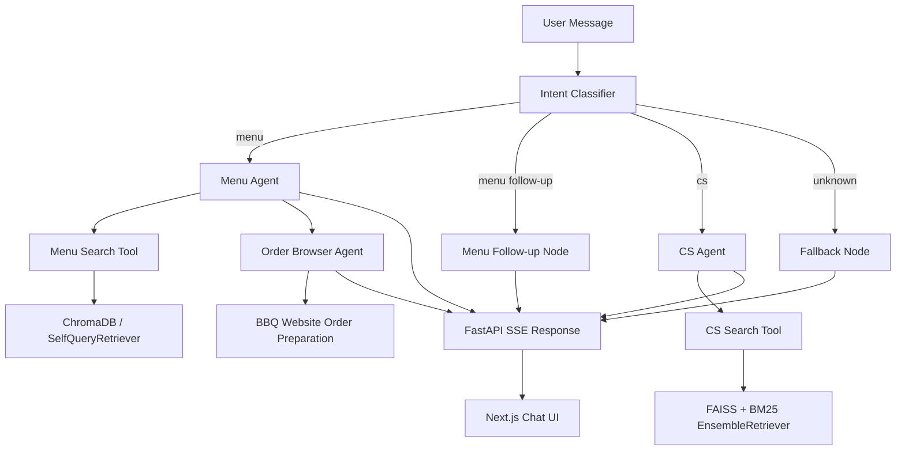

# BBQ Menu & CS Agent

BBQ 메뉴 추천과 고객 문의 응답을 처리하는 LangGraph 기반 AI 챗봇 프로젝트입니다.  
사용자의 자연어 입력을 분석해 메뉴 추천, 고객센터 문의, 주문 준비 흐름으로 라우팅하고, FastAPI와 Next.js를 통해 실시간 채팅 UI로 제공합니다.

## Demo

> LangGraph 기반 Agent 라우팅, RAG 검색, SSE 스트리밍을 적용한 BBQ 메뉴 추천 및 CS 응답 챗봇입니다.

데모 영상 추가 예정

영상에서 보여줄 주요 흐름:

- 메뉴 추천: "매운 치킨 추천해줘"
- CS 응답: "환불은 어떻게 해?"
- 주문 준비: 선택한 메뉴와 옵션을 바탕으로 BBQ 사이트 장바구니 준비
- 실시간 응답: SSE 기반 스트리밍 출력

## 주요 기능

- 사용자 질문 의도 분류
- BBQ 메뉴 추천 Agent
- 고객센터 CS 응답 Agent
- 메뉴 후속 추천 처리
- 메뉴 카드 UI 렌더링
- SSE 기반 실시간 응답 스트리밍
- 세션 기반 대화 관리
- 선택한 메뉴/옵션 기반 주문 준비 플로우
- 수동 체크포인트를 통한 로그인/주소 입력 등 사용자 개입 처리

## 기술 스택

| 영역 | 기술 |
| --- | --- |
| Frontend | Next.js, React, TypeScript, Tailwind CSS |
| Backend | FastAPI, Pydantic |
| Agent | LangGraph, LangChain |
| LLM | OpenAI GPT-4o-mini |
| Embedding | OpenAI text-embedding-3-large |
| Vector Search | ChromaDB, FAISS |
| Keyword Search | BM25 |
| Streaming | Server-Sent Events |
| Test | pytest |

## 시스템 구조



## 핵심 구현 내용

### 1. LangGraph 기반 Agent 라우팅

사용자 입력을 먼저 intent classifier가 분류한 뒤, 목적에 맞는 노드로 라우팅합니다.

- 메뉴 추천 요청 -> Menu Agent
- 추가 추천 요청 -> Menu Follow-up Node
- 고객센터 문의 -> CS Agent
- 주문 준비 요청 -> Order Browser Agent
- 처리 불가 요청 -> Fallback Node

이를 통해 단순 프롬프트 호출이 아니라, 역할이 분리된 AI 워크플로우로 챗봇을 구성했습니다.

### 2. 메뉴 추천 검색

메뉴 추천에는 ChromaDB와 SelfQueryRetriever를 사용했습니다.  
사용자의 자연어 요청에서 가격, 매운맛, 식감, 카테고리 같은 조건을 추출해 메뉴 검색에 반영합니다.

예시:

```txt
입력: 2만원 이하 매운 치킨 추천해줘
처리: price <= 20000, spiciness = spicy 조건으로 메뉴 검색
```

추상적인 추천 요청은 별도 추천 기준을 적용해 후보 메뉴를 재정렬합니다.

예시:

- 맥주와 어울리는 메뉴
- 아이와 먹기 좋은 메뉴
- 혼자 먹기 좋은 메뉴

### 3. CS 문의 검색

고객센터 문의는 FAISS와 BM25를 결합한 hybrid retrieval 방식으로 처리했습니다.

- BM25: 키워드가 명확한 문의에 강점
- FAISS: 의미적으로 유사한 문의에 강점
- EnsembleRetriever: 두 검색 결과를 결합해 응답 품질 보완

이를 통해 "환불", "배달", "쿠폰", "기프티콘" 같은 CS 질문에 관련 사례를 찾아 답변합니다.

### 4. 실시간 채팅 UI

백엔드는 SSE로 토큰과 최종 메시지를 스트리밍하고, 프론트엔드는 Next.js Route Handler를 통해 FastAPI 응답을 중계합니다.

스트리밍 이벤트는 다음 흐름으로 처리됩니다.

```txt
start -> token -> message -> done
```

메뉴 추천 결과는 단순 텍스트가 아니라 메뉴 카드 형태로 보여주며, 가격, 카테고리, 설명, 이미지, 추천 이유를 함께 제공합니다.

## API

주요 런타임 API는 세션 기반으로 구성했습니다.

| Method | Endpoint | 설명 |
| --- | --- | --- |
| POST | `/sessions` | 새 채팅 세션 생성 |
| GET | `/sessions/{session_id}` | 세션 정보 조회 |
| GET | `/sessions/{session_id}/messages` | 메시지 목록 조회 |
| POST | `/sessions/{session_id}/responses` | 일반 응답 생성 |
| POST | `/sessions/{session_id}/responses/stream` | SSE 스트리밍 응답 생성 |
| DELETE | `/sessions/{session_id}` | 세션 삭제 |
| GET | `/health` | 서버 상태 확인 |

## 실행 방법

### 백엔드 실행

```bash
pip install -r requirements.txt
uvicorn main:app --reload
```

### 프론트엔드 실행

```bash
cd frontend
npm install
npm run dev
```

브라우저에서 아래 주소로 접속합니다.

```txt
http://localhost:3000
```

## 환경 변수

OpenAI API Key를 설정해야 합니다.

```env
OPENAI_API_KEY=your_openai_api_key
```

프론트엔드에서 백엔드 주소를 변경하려면 다음 값을 설정합니다.

```env
BACKEND_URL=http://localhost:8000
```

## 테스트

```bash
pytest
```

일부 브라우저 주문 준비 테스트는 브라우저 실행 환경과 별도 설정이 필요할 수 있습니다.

## 프로젝트 구조

```txt
.
├── api/                 # FastAPI router, schema, service layer
├── graph/               # LangGraph state graph and agent nodes
├── tools/               # Menu search, CS search, order preparation tools
├── browser/             # BBQ 웹사이트 주문 준비 자동화 관련 코드
├── tests/               # pytest 테스트
├── docs/                # API 문서 및 설계 문서
├── frontend/            # Next.js chat UI
├── main.py              # FastAPI entrypoint
└── requirements.txt
```

## 트러블슈팅 및 개선 포인트

- 메뉴 추천 결과가 요청한 상품군과 어긋나는 문제를 줄이기 위해 product family 기반 필터링을 추가했습니다.
- "다른 메뉴 추천해줘" 같은 후속 요청에서는 이미 보여준 메뉴를 제외하고 새 후보를 반환하도록 처리했습니다.
- 주문 준비 과정에서 로그인, 주소 선택, 결제처럼 사용자가 직접 해야 하는 단계는 manual checkpoint로 분리했습니다.
- CS 응답은 검색된 문서 기반으로만 답변하도록 제한해 근거 없는 답변 생성을 줄였습니다.

## 향후 개선 사항

- 대화 기록 영구 저장
- 사용자 선호도 기반 개인화 추천
- 관리자용 메뉴/CS 데이터 관리 화면
- 검색 결과 근거 표시 강화
- 배포 환경에서의 인증 및 rate limiting 추가

## 프로젝트 의의

이 프로젝트는 단순한 챗봇 UI가 아니라, 사용자 의도를 분류하고 목적에 맞는 Agent와 검색 도구를 조합해 응답하는 AI 서비스 구조를 구현한 프로젝트입니다.  
LangGraph 기반 워크플로우, RAG 검색, hybrid retrieval, SSE 스트리밍, 세션 기반 API 설계를 함께 적용해 실제 서비스 형태의 AI 챗봇을 목표로 개발했습니다.
